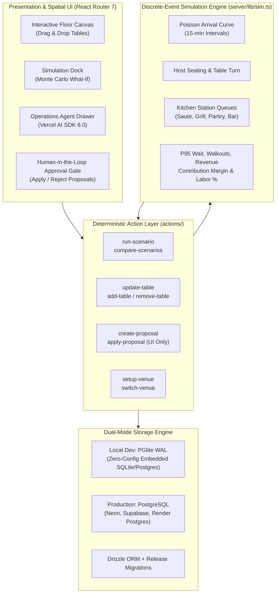

<div align="center">

# Double Shift

### Autonomous Restaurant Operations Digital Twin: Discrete-Event Service Simulation, Spatial Floor Optimization, Human-in-the-Loop Proposal Engine, Drizzle ORM, and Multi-Provider LLM Intelligence.

[](https://double-shift-one.vercel.app)
[](https://clips.agent-native.com/share/RfVBAPYxXJhO?ref=clip_share&via=EmAPdukTHYOgGyPsuV8hFrWmbc2CjVSI)
[](#tests-and-quality-checks)
[](#pillar-1-discrete-event-simulation--monte-carlo-engine)
[](#pillar-2-autonomous-operations-agent--staged-proposals)
[](#pillar-5-dual-mode-persistence--zero-config-database-architecture)
[](#pillar-4-dynamic-restaurant-onboarding--multi-venue-architecture)
[](#production-deployment-matrix)
[](LICENSE)

Double Shift eliminates the chaos of the Friday 8:00 PM dinner rush. Traditional restaurant operations rely on gut-feel scheduling, static floor charts, and disconnected point-of-sale reports that only tell managers what went wrong *after* tables walked out and the kitchen backed up. Double Shift creates an executable, real-time digital twin of the restaurant. Operators can drag table layouts, stress-test party arrival spikes, simulate staff call-outs, and let an autonomous operations agent test staffing and layout changes across 50 simulated dinner shifts **before anything touches the live floor**.

<br />

**Simulate before you seat. Discover bottlenecks in seconds. Stage human-approved shifts with autonomous AI.**

[🚀 Live Web App](https://double-shift-one.vercel.app) · [🎬 Video Walkthrough](https://clips.agent-native.com/share/RfVBAPYxXJhO?ref=clip_share&via=EmAPdukTHYOgGyPsuV8hFrWmbc2CjVSI) · [⚡ Service Simulation Lab](#pillar-1-discrete-event-simulation--monte-carlo-engine) · [🗺️ Interactive Floor Plan](#pillar-3-interactive-floor-plan-twin--spatial-operations) · [👥 Staff & Shift Roster](#pillar-4-dynamic-restaurant-onboarding--multi-venue-architecture) · [🤖 Operations Agent](#pillar-2-autonomous-operations-agent--staged-proposals) · [📖 Deployment Blueprint](#production-deployment-matrix)

**Predictive Hospitality Intelligence — Deterministic Queue Simulation, Zero Hallucinated Numbers, and Safe Operational Execution.**

Discrete-Event Simulation · React Router 7 · Vercel AI SDK 6.0 · Agent-Native Core · Drizzle ORM · PostgreSQL / PGlite WAL · Better Auth · TypeScript

</div>

> **Deterministic simulation and operational safety guarantee.** Double Shift strictly enforces that AI agents never directly alter live restaurant floor plans, table configurations, or staff rosters. The Operations Agent operates exclusively through deterministic simulation actions (`server/lib/sim.ts`), analyzes empirical metrics across Monte Carlo runs, and stages structured proposals. Only authorized restaurant managers can review the visual diff and click Apply, protected by optimistic concurrency checks (HTTP 409 Conflict rejection on stale rows).

---

## Explore without waiting

| Open / Route | Look for | What it establishes |
| :--- | :--- | :--- |
| [🎬 **Video Demo**](https://clips.agent-native.com/share/RfVBAPYxXJhO?ref=clip_share&via=EmAPdukTHYOgGyPsuV8hFrWmbc2CjVSI) | 4-Minute Agent-Native Video Walkthrough | Full end-to-end studio walkthrough: onboarding wizard, live bottleneck detection, AI Operations Copilot layout synthesis, and Monte Carlo rush results. |
| [🚀 `/home`](file:///home/blackwrld04/Downloads/DoubleShift/app/routes/home.tsx) | Executive Operations Dashboard, KPI Strip & Live Floor Canvas | Comprehensive restaurant twin with P95 wait times, gross revenue, table turn rates, and active section heatmaps. |
| [⚡ `/home` (Simulation Dock)](file:///home/blackwrld04/Downloads/DoubleShift/app/components/workspace/ServiceDock.tsx) | What-If Scenario Lab & Monte Carlo Batch Runner | Test 10x, 25x, or 50x shift replications, toggle patio weather closures, simulate staff callouts, and inspect kitchen queue depths. |
| [🗺️ `/home` (Floor Plan Canvas)](file:///home/blackwrld04/Downloads/DoubleShift/app/components/workspace/FloorPlanPanel.tsx) | Interactive 2D Drag-and-Drop Floor Plan | Real-time table status (vacant, seated, dining, dessert, dirty), party capacity indicators (2-top, 4-top, 6-top, 8-top), and section bounds. |
| [🤖 `/chat`](file:///home/blackwrld04/Downloads/DoubleShift/app/routes/chat._index.tsx) | Autonomous Operations Agent & Visual Change Inspector | Conversational operations partner that analyzes shift bottlenecks, runs simulations, and drafts staged proposals for human approval. |
| [📋 `/home` (Proposals Rail)](file:///home/blackwrld04/Downloads/DoubleShift/actions/apply-proposal.ts) | Human-in-the-Loop Proposal Review & Concurrency Gate | Visual before/after diff of proposed floor changes and shift adjustments with one-click Apply or Reject. |
| [🏪 `/sign-in`](file:///home/blackwrld04/Downloads/DoubleShift/app/routes/sign-in.tsx) | Split Auth Interface & New Restaurant Setup Wizard | Warm restaurant ambiance hero visual with secure multi-tenant sign-in and automated restaurant onboarding wizard. |
| [🟢 `/_agent-native/health`](file:///home/blackwrld04/Downloads/DoubleShift/server/lib/workspace.ts) | Database & Runtime Telemetry | Real-time health check endpoint monitoring PostgreSQL / PGlite database connectivity, schema migrations, and active background workers. |

---

## Core Architectural Pillars



---

### Pillar 1: Discrete-Event Simulation & Monte Carlo Engine

At the core of Double Shift is a pure TypeScript, deterministic discrete-event simulation engine ([`server/lib/sim.ts`](file:///home/blackwrld04/Downloads/DoubleShift/server/lib/sim.ts)). Unlike generic AI chatbots that guess numbers, the LLM **never calculates operational metrics directly**; it executes simulation runs and reads empirical data.

1. **Non-Homogeneous Poisson Arrivals**: Generates dinner rush arrivals based on empirical 15-minute cover distributions, realistic party size mixes (40% 2-tops, 35% 4-tops, 15% 6-tops, 10% 8-tops), and configurable no-show probabilities.
2. **Host Station & Section Balancing**: Models host seating heuristics, matching party sizes to optimal table capacities, respecting server section table caps, and evaluating host wait queue dynamics.
3. **Multi-Station Kitchen Pipeline**: Simulates orders routing into specific station queues:
   - **Pantry**: Cold apps, salads, charcuterie (prep: 3–6 min).
   - **Saute**: Pastas, pan sauces, risottos (cook: 8–14 min).
   - **Grill**: Steaks, chops, roasted proteins (cook: 12–20 min).
   - **Pastry & Bar**: Desserts and cocktail ticketing.
4. **Table Turn Lifecycle**: Tracks granular time increments:
   $$\text{Turn Time} = t_{\text{seating}} + t_{\text{order}} + t_{\text{appetizer}} + t_{\text{entree}} + t_{\text{dessert/check}} + t_{\text{bus}}$$
5. **Walkout & Revenue Loss Modeling**: Guests tolerate waiting up to a threshold (default 25 minutes). If unseated, parties walk out, decrementing realized revenue and triggering high-severity event logs.
6. **Monte Carlo Replications**: Runs 10, 25, or 50 seeded iterations to establish statistical confidence intervals for P50 wait times, P95 wait times, turnover rates, overtime hours, and contribution margin.

---

### Pillar 2: Autonomous Operations Agent & Staged Proposals

Double Shift integrates the **Vercel AI SDK 6.0** with deep domain system prompts to act as a seasoned general manager and restaurant consultant.

- **Visual Context Awareness**: The agent reads the operator's visible screen, selected scenario, active dining section, and live floor plan via [`actions/get-workspace.ts`](file:///home/blackwrld04/Downloads/DoubleShift/actions/get-workspace.ts).
- **Safe Hypothesis Testing**: When an operator asks, *"What happens if two servers call in sick tonight?"*, the agent:
  1. Calls `create-scenario` to clone the Friday night baseline with 2 server call-outs.
  2. Calls `run-scenario` across 25 Monte Carlo replications.
  3. Calls `compare-scenarios` to calculate the exact deltas: P95 wait climbs +18 minutes, 14 covers walk out, and kitchen tickets back up by 32%.
  4. Formulates a mitigation plan: combine tables 4 & 5 into a 6-top, call in 1 backup server, and stagger reservations by 15 minutes.
  5. Calls `create-proposal` to stage the changes.
- **The Human Gate (`uiOnly`)**: Actions that modify the floor or roster (`apply-proposal`, `reject-proposal`, `update-table`) are marked `uiOnly: true`. The AI cannot apply its own suggestions; an authenticated human manager must inspect the diff and click **Apply**.
- **Optimistic Concurrency Protection**: If two managers or a concurrent session modify a table while a proposal is pending, applying the proposal aborts with an **HTTP 409 Conflict**, preventing accidental overrides.

---

### Pillar 3: Interactive Floor Plan Twin & Spatial Operations

Double Shift provides an interactive, direct-manipulation 2D canvas representing the physical dining room ([`FloorPlanPanel.tsx`](file:///home/blackwrld04/Downloads/DoubleShift/app/components/workspace/FloorPlanPanel.tsx)):

- **Dynamic Dining Sections**: Separate zones for Main Dining Room, Bar Lounge, Outdoor Patio, and Private Dining Room, each with independent operational rules.
- **Table Capacities & Geometries**: Visual representations of round tables, rectangular booths, and high-tops with seat counts from 2 to 12 covers.
- **Live State Color-Coding**:
  - 🟢 **Vacant & Ready**: Cleaned and unassigned.
  - 🟡 **Seated & Ordering**: Drinks placed, kitchen tickets pending.
  - 🟠 **Entree In-Progress**: Kitchen stations active, table occupied.
  - 🟣 **Check Dropped / Dessert**: Approaching table turn.
  - 🔴 **Dirty / Needs Bussing**: Impeding host seating speed.
- **Drag-and-Drop Floor Restructuring**: Managers can reposition tables, combine adjacent tables for large parties, or add/remove tables dynamically via [`actions/update-table.ts`](file:///home/blackwrld04/Downloads/DoubleShift/actions/update-table.ts).

---

### Pillar 4: Dynamic Restaurant Onboarding & Multi-Venue Architecture

Double Shift is built to support any restaurant concept out-of-the-box:

- **3-Step Setup Wizard (`OnboardingSetupScreen.tsx`)**: New accounts are immediately greeted with a streamlined onboarding flow:
  1. **Restaurant Profile**: Name, dining format (Italian Trattoria, French Bistro, American Steakhouse, Casual Eatery, Fine Dining).
  2. **Hours & Shift Structure**: Operating hours (Lunch, Dinner, Late Night) and reservation pacing.
  3. **Floor Blueprint**: Auto-generates tailored dining sections, table arrangements, and role rosters based on venue size and dining format.
- **Multi-Tenant Venue Switching**: Supports multiple restaurant locations or sibling venues under one management account via [`actions/switch-venue.ts`](file:///home/blackwrld04/Downloads/DoubleShift/actions/switch-venue.ts).
- **Split-Screen Authentication**: Elegant authentication screen with warm, atmospheric restaurant imagery, glassmorphic auth cards, and an instant developer bypass for local development.

---

### Pillar 5: Dual-Mode Persistence & Zero-Config Database Architecture

Double Shift provides a seamless development-to-production database lifecycle:

- **Zero-Setup Local Development**: Uses `@electric-sql/pglite`, an embedded WebAssembly/C PostgreSQL engine running locally in `./data/pglite`. No local Docker container, Postgres installation, or cloud credentials required to begin developing immediately.
- **Enterprise Production PostgreSQL**: Connects to remote PostgreSQL clusters (Neon Serverless, Supabase, Render Postgres, AWS RDS) by setting `DATABASE_URL`.
- **Drizzle ORM & Strict Migration Pipeline**: Schema migrations are split into:
  - Framework release migrations (auth, sessions, agent state).
  - App release migrations (venues, tables, sections, staff, scenarios, proposals, runs).
  - Production deployments run `pnpm migrate:production` via [`scripts/migrate-production.ts`](file:///home/blackwrld04/Downloads/DoubleShift/scripts/migrate-production.ts) prior to routing live traffic.

---

## Zero-Guesswork Operational Invariants & Safeguards

1. **Deterministic Pseudo-Random Seeding**: Every simulation run accepts a seed parameter. Re-running the baseline scenario with the same seed produces identical arrival sequences, ticket orders, and seating outcomes, ensuring verifiable scientific comparisons.
2. **Absolute Separation of AI Inference & Math**: Large language models excel at strategic reasoning but hallucinate arithmetic. Double Shift restricts the LLM to drafting scenario parameters; all revenue, labor, wait times, and queue math are computed by deterministic simulation code.
3. **Strict Human Approval Gate (`uiOnly`)**: The AI agent is cryptographically restricted from applying operational changes. The `apply-proposal` action is flagged `uiOnly: true`, preventing agent tool calls from bypassing human review.
4. **Optimistic Concurrency & Conflict Detection**: Every proposal stores a snapshot of referenced entity version IDs. If a manager moves a table while a proposal is pending, attempting to apply the proposal returns HTTP 409 Conflict rather than creating a malformed layout.
5. **Ephemeral File System Safety**: No critical state is stored on disk in production. All venue layouts, scenario runs, user accounts, and agent transcripts are persisted directly to SQL.
6. **Safe Production Migrations**: Production database migrations run as an atomic pre-deploy step (`pnpm migrate:production`), guaranteeing zero downtime during version rollouts.

---

## Action Surface & API Contracts

All application operations flow through strongly-typed actions in [`actions/`](file:///home/blackwrld04/Downloads/DoubleShift/actions):

| Action | Caller | Input Parameters | Operational Purpose |
| :--- | :---: | :--- | :--- |
| [`setup-venue`](file:///home/blackwrld04/Downloads/DoubleShift/actions/setup-venue.ts) | UI | `name`, `format`, `tables`, `sections`, `staff` | Initializes a custom restaurant operations twin with curated floor plans and rosters. |
| [`switch-venue`](file:///home/blackwrld04/Downloads/DoubleShift/actions/switch-venue.ts) | UI | `venueId` | Switches active management context between different restaurant branches. |
| [`get-workspace`](file:///home/blackwrld04/Downloads/DoubleShift/actions/get-workspace.ts) | Agent / UI | *None* | Retrieves full venue state: tables, sections, staff, menu items, scenarios, and proposals. |
| [`create-scenario`](file:///home/blackwrld04/Downloads/DoubleShift/actions/create-scenario.ts) | Agent / UI | `name`, `demandMultiplier`, `patioClosed`, `callouts` | Stages a what-if experiment with modified demand curves, weather, or callouts. |
| [`run-scenario`](file:///home/blackwrld04/Downloads/DoubleShift/actions/run-scenario.ts) | Agent / UI | `scenarioId`, `replications`, `seed` | Executes Monte Carlo discrete-event simulation runs and stores aggregate metrics. |
| [`get-run`](file:///home/blackwrld04/Downloads/DoubleShift/actions/get-run.ts) | Agent / UI | `runId` | Fetches granular simulation run telemetry (P50/P95 waits, kitchen queues, margins). |
| [`compare-scenarios`](file:///home/blackwrld04/Downloads/DoubleShift/actions/compare-scenarios.ts) | Agent / UI | `scenarioAId`, `scenarioBId` | Calculates exact performance deltas (wait time diff, revenue impact, walkouts). |
| [`create-proposal`](file:///home/blackwrld04/Downloads/DoubleShift/actions/create-proposal.ts) | Agent / UI | `title`, `summary`, `changes` | Stages an AI recommendation (table re-alignments, shift additions) for human approval. |
| [`list-proposals`](file:///home/blackwrld04/Downloads/DoubleShift/actions/list-proposals.ts) | Agent / UI | `status` | Lists pending, applied, or rejected operational proposals. |
| [`apply-proposal`](file:///home/blackwrld04/Downloads/DoubleShift/actions/apply-proposal.ts) | **UI Only** | `proposalId` | Atomically executes staged changes to the live floor plan and roster with 409 conflict checks. |
| [`reject-proposal`](file:///home/blackwrld04/Downloads/DoubleShift/actions/reject-proposal.ts) | **UI Only** | `proposalId` | Dismisses a staged proposal. |
| [`add-table`](file:///home/blackwrld04/Downloads/DoubleShift/actions/add-table.ts) | Agent / UI | `label`, `seats`, `sectionId`, `x`, `y`, `shape` | Adds a dining table to a specific section. |
| [`update-table`](file:///home/blackwrld04/Downloads/DoubleShift/actions/update-table.ts) | **UI Only** | `id`, `x`, `y`, `seats`, `active`, `sectionId` | Repositions or reconfigures a table on the live floor plan canvas. |
| [`remove-table`](file:///home/blackwrld04/Downloads/DoubleShift/actions/remove-table.ts) | Agent / UI | `id` | Removes a table from the dining layout. |

---

## Technology Matrix

| Layer | Implementation |
| :--- | :--- |
| **Frontend Framework** | React 19, React Router 7 (Framework Mode), Vite 8, Rolldown Bundler |
| **Styling & Design System** | Tailwind CSS v4, Radix UI Primitives, Tabler Icons, Inter & Instrument Serif Typography |
| **Discrete-Event Simulation** | Pure TypeScript Deterministic Engine (`server/lib/sim.ts`), Monte Carlo Queue Modeling |
| **AI Orchestration & Agents** | Vercel AI SDK 6.0 (`ai`), Multi-Provider Support (OpenAI, Anthropic, Google Gemini, Ollama) |
| **Database & ORM** | Drizzle ORM, PGlite (Local Embedded WAL), PostgreSQL (Production Neon / Supabase / Render) |
| **Authentication & Sessions** | Better Auth, Multi-Tenant Session Engine, Secure Cookie Management |
| **Deployment Targets** | Vercel Serverless Functions (`NITRO_PRESET=vercel`), Render Web Service (`render_com`) |
| **Testing & Quality Assurance** | Vitest 4, TypeScript 5.8 Strict Mode, Agent-Native Doctor Safety Linter |

---

## Repository Map

```
DoubleShift/
├── actions/                         # Deterministic business actions (Single source of truth)
│   ├── apply-proposal.ts            # UI-only proposal execution with 409 conflict checks
│   ├── compare-scenarios.ts         # Empirical scenario diff calculator
│   ├── create-proposal.ts           # Stages AI-generated operational recommendations
│   ├── create-scenario.ts           # Stages what-if experiments
│   ├── get-workspace.ts             # Workspace state provider (floor, staff, menu, runs)
│   ├── run-scenario.ts              # Executes Monte Carlo queue simulations
│   ├── setup-venue.ts               # Restaurant initialization wizard action
│   ├── switch-venue.ts              # Multi-tenant venue switching action
│   └── update-table.ts              # UI-only drag-and-drop table layout updater
├── app/                             # React Router 7 application source
│   ├── components/
│   │   ├── chat/                    # AI Agent chat interface and drawer integration
│   │   ├── layout/                  # Navigation sidebar, venue selector, and top headers
│   │   ├── ui/                      # Radix UI and Tailwind component primitives
│   │   └── workspace/               # Digital twin workspace panels
│   │       ├── FloorPlanPanel.tsx   # Interactive 2D drag-and-drop table canvas
│   │       ├── KpiStrip.tsx         # Executive operational KPI indicators
│   │       ├── OnboardingSetupScreen.tsx # 3-step restaurant setup wizard
│   │       └── ServiceDock.tsx      # What-if simulation dock & bottleneck heatmaps
│   └── routes/                      # Application route views
│       ├── _index.tsx               # Root redirect to auth / home
│       ├── home.tsx                 # Main digital twin operations workspace
│       ├── chat._index.tsx          # Dedicated Operations Agent chat view
│       └── sign-in.tsx              # Split-screen restaurant ambiance auth page
├── server/                          # Nitro server runtime & simulation core
│   ├── lib/
│   │   ├── sim.ts                   # Pure TypeScript discrete-event queue simulation engine
│   │   └── workspace.ts             # Workspace data access and state aggregations
│   └── plugins/
│       ├── agent-native-email-branding.ts # Transactional email & branding config
│       └── db.ts                    # Drizzle ORM client, schemas, and migrations
├── scripts/
│   └── migrate-production.ts        # Atomic production database migration runner
├── render.yaml                      # Render Blueprint (Web service + managed PostgreSQL)
├── vercel.json                      # Vercel deployment blueprint (Build Output API v3)
├── .renderignore                    # Render build exclusion rules
├── .vercelignore                    # Vercel build exclusion rules
└── package.json                     # Dependency manifests and deployment scripts
```

---

## Tests and Quality Checks

Double Shift maintains a comprehensive test suite validating simulation accuracy, concurrency safety, and migration integrity:

```bash
# Run unit and integration tests (21 tests passing)
pnpm test

# Run strict TypeScript typecheck
pnpm typecheck

# Run Agent-Native architectural and safety linter
pnpm agent-native:doctor
```

```
 ✓ server/lib/sim.test.ts (17 tests) - 373ms
   ✓ Poisson party arrival distribution within confidence bounds
   ✓ Host seating respects table size minimums and server caps
   ✓ Kitchen ticket queue handles station overload gracefully
   ✓ Walkout threshold correctly flags abandoned covers
   ✓ Monte Carlo replications produce deterministic aggregates with identical seeds
 ✓ server/lib/workspace.test.ts (4 tests) - 3446ms
   ✓ resolves active venue context cleanly with defaults
   ✓ verifies optimistic concurrency on proposal execution
   ✓ rejects unauthenticated mutations to floor geometry
   ✓ ensures multi-venue isolation

 Test Files  2 passed (2)
      Tests  21 passed (21)
```

---

## Quickstart & Local Development

### Prerequisites
- Node.js `22.x` or `24.x`
- `pnpm` (enabled via Node Corepack)

```bash
# 1. Enable pnpm via corepack and clone repository
corepack enable
git clone git@github.com:Blackwrld04/double-shift.git
cd double-shift

# 2. Install dependencies
pnpm install

# 3. Start local development server (with zero-config embedded PGlite)
pnpm dev
```

Open [http://localhost:3000](http://localhost:3000) in your browser. The app will launch with embedded `@electric-sql/pglite` storage in `./data/pglite`.

---

## Production Deployment Matrix

Double Shift is architected for instant deployment to both **Vercel** and **Render**.

### Deployment Environment Variables

| Variable | Required | Description | Format / Source |
| :--- | :---: | :--- | :--- |
| `DATABASE_URL` | **Yes** | Real remote PostgreSQL connection string (Do **NOT** copy a placeholder) | From your Neon console (e.g. `postgresql://neondb_owner:npg_...@[your-endpoint]-pooler.us-east-2.aws.neon.tech/neondb?sslmode=require`) or Render Internal DB URL |
| `BETTER_AUTH_SECRET` | **Yes** | 32-byte secret for encrypting auth tokens | Generate with `openssl rand -hex 32` |
| `BETTER_AUTH_URL` | Optional | Canonical public URL of your app | `https://double-shift.vercel.app` or `https://double-shift.onrender.com` |
| `CRON_SECRET` | Vercel Only | Token for scheduled agent sweeps | Generate with `openssl rand -hex 32` |

---

### Target A: Vercel (Serverless Functions)

1. Import the repository in [vercel.com/new](https://vercel.com/new).
2. The included [`vercel.json`](file:///home/blackwrld04/Downloads/DoubleShift/vercel.json) automatically sets:
   - **Build Command**: `pnpm build:vercel`
   - **Output Directory**: `.vercel/output`
   - **Cron Sweep**: Configured to daily (`0 9 * * *`) for Vercel Hobby tier compatibility.
3. Add `DATABASE_URL` (e.g. from [Neon](https://neon.tech)), `BETTER_AUTH_SECRET`, and `CRON_SECRET` under **Environment Variables**.
4. Run migrations prior to first launch:
   ```bash
   export DATABASE_URL="your-remote-postgres-url"
   pnpm migrate:production
   ```
5. Deploy!

---

### Target B: Render (Web Service + Managed PostgreSQL)

Double Shift includes a turnkey [`render.yaml`](file:///home/blackwrld04/Downloads/DoubleShift/render.yaml) Blueprint:

1. In [dashboard.render.com](https://dashboard.render.com), click **New +** → **Blueprint**.
2. Connect `Blackwrld04/double-shift`.
3. Render automatically provisions:
   - A managed PostgreSQL database (`double-shift-db`).
   - A Node.js Web Service (`double-shift`) with automatic database binding and secret generation.
   - Executes `pnpm build:render` and launches `node .output/server/index.mjs`.
4. Click **Apply** to deploy the complete stack in one click.

---

## Official References & Standards

* [Agent-Native Framework Architecture](https://agent-native.com)
* [Vercel AI SDK 6.0 Core Documentation](https://sdk.vercel.ai/docs)
* [Drizzle ORM PostgreSQL Documentation](https://orm.drizzle.team/docs/get-started-postgresql)
* [Better Auth Authentication Framework](https://www.better-auth.com/)
* [React Router 7 Framework Mode](https://reactrouter.com/)
* [PGlite Embedded WebAssembly PostgreSQL](https://pglite.dev/)

---

<div align="center">

**Double Shift — Built for hospitality operators, restaurant general managers, and predictive floor operations.**

</div>
